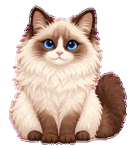

# 布偶猫 Codex 宠物 / Ragdoll Codex Pet

一只非官方的布偶猫桌面宠物：奶油色长毛、深色重点色和蓝眼睛。图集采用 Codex 宠物 v2 布局，包含九种工作状态和十六个视线方向。



## 安装

把仓库根目录的 `pet.json` 和 `spritesheet.png` 一起放到 Codex 的自定义宠物目录：

```text
Windows: %USERPROFILE%\.codex\pets\ragdoll-cat\
macOS/Linux: ~/.codex/pets/ragdoll-cat/
```

然后在 Codex 的宠物设置中刷新列表，选择“布偶猫”。如果 Codex 使用了自定义 `CODEX_HOME`，请放到该目录下的 `pets/ragdoll-cat/`。

## 内容

| 路径 | 内容 |
| --- | --- |
| `pet.json`, `spritesheet.png` | 可直接安装的 v2 宠物包 |
| `previews/` | 动作 GIF、MP4、接触表和视线方向表 |
| `process/decoded/` | ImageGen 生成的基础图、动作条、方向条和修订稿 |
| `process/prompts/` | 各阶段的生成提示词 |
| `process/references/` | 基础形象、布局参考和四个方向锚点 |
| `process/final/`, `process/qa/` | 合成中间产物、逐帧图和验证报告 |
| `archive/v1/` | 第一版变形动画原型和三视角源图 |

最终图集为透明 PNG，尺寸 **1536 × 2288**，每格 **192 × 208**，共 8 列、11 行。标准动作依次为待机、向右移动、向左移动、挥手、跳跃、失败、等待、工作和检查；最后两行是顺时针的十六个视线方向。

## 构建与验证

流程和中间文件见 [BUILD.md](BUILD.md)。最终图集通过了尺寸、透明度、色边、动作帧与方向帧检查；`process/qa/pet-quality.json` 记录了完整结果。构建报告中仍保留两条供人工复核的方向连续性提示，详情见该报告。

源图和动画条使用 OpenAI ImageGen 生成，裁切、对齐、合成与验证使用 Pets 工作流脚本。仓库公开供查看构建过程；当前未附开放使用许可。
